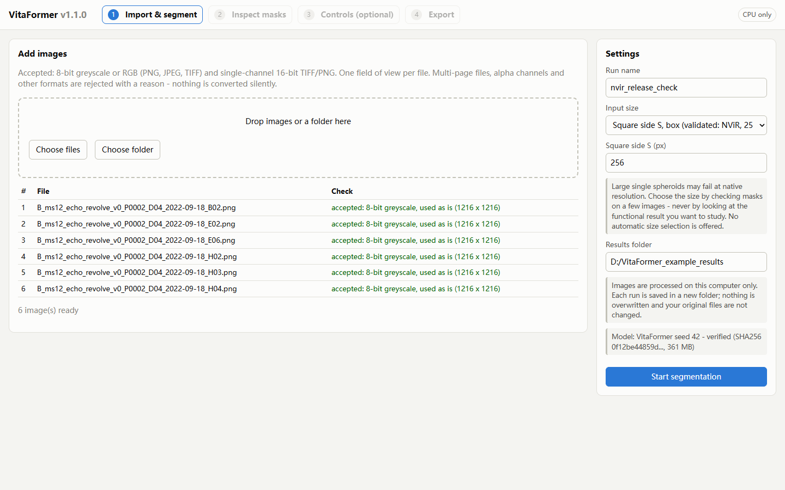
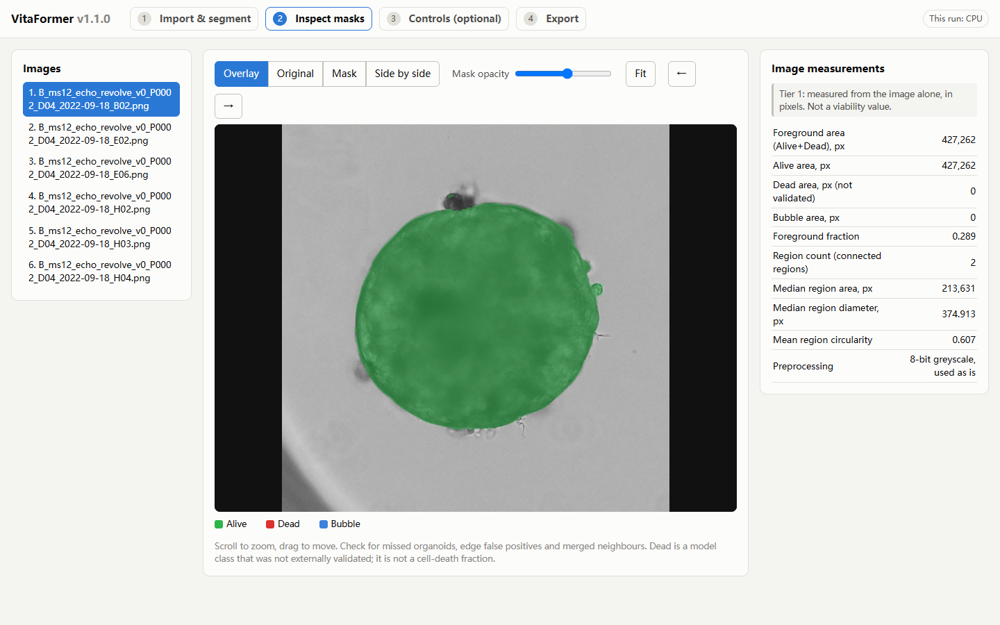
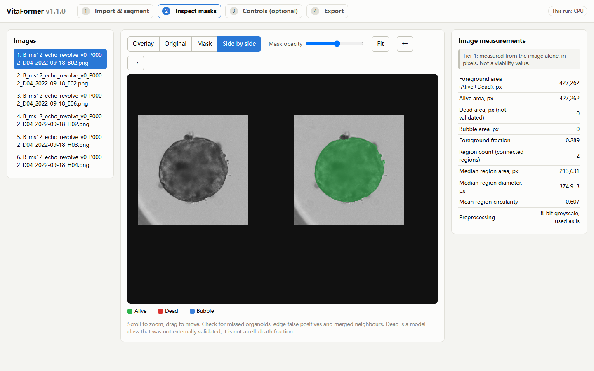
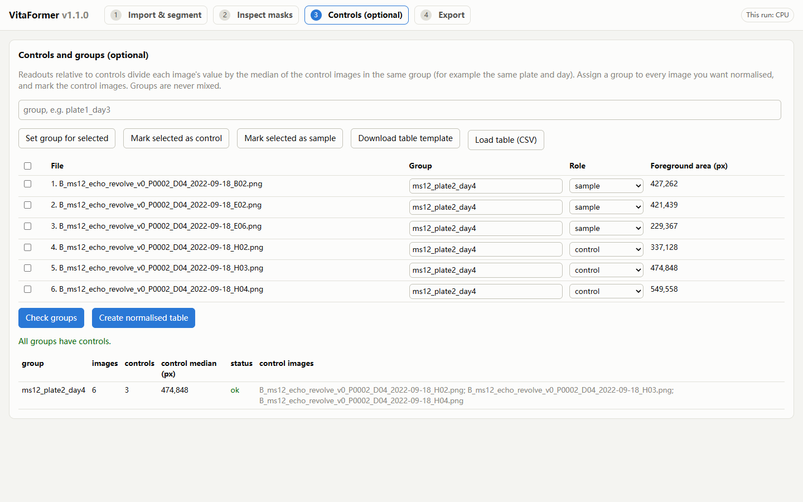
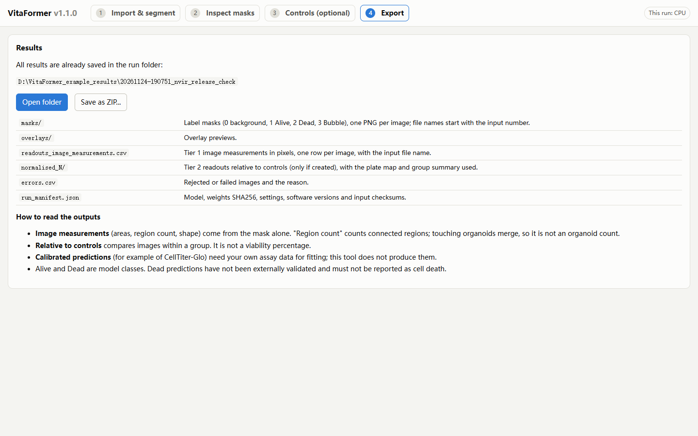

# VitaFormer — user guide (v1.1.0)

The application has four pages, shown as numbered steps at the top of the window. The screenshots use the NViR example images
(`examples/nvir`). The menu bar of the window offers **New analysis**, **Results folder** (opens the default results folder) and **Help**.

## 1. Import and segment

1. Press **Choose files** or **Choose folder**, or drag images or a folder into the drop area.
2. Each file is checked when it is added. Files that cannot be used are listed with the reason (for example an alpha channel,
   a multi-page TIFF or an unsupported format) and are not processed. Accepted: 8-bit greyscale or RGB PNG/JPEG/TIFF and
   single-channel 16-bit TIFF/PNG. 16-bit images are stretched per image (1st–99th percentile) to 8 bit; this is recorded.
3. In **Settings**:
   - **Run name** becomes part of the result folder name.
   - **Input size**:
     - *Native resolution* — default; validated for CRC and DeepOrganoid images.
     - *Scale factor, bilinear* — validated with factor 0.25 for GemcitabineScreen images.
     - *Square side S, box* — validated with S = 256 for NViR liver spheroids; square images only.
   - **Results folder** — default `%USERPROFILE%\VitaFormer_results`.
   - The model box shows whether the built-in weights passed their SHA256 check. Segmentation is only possible if they did.
4. Press **Start**. **Cancel** stops after the current image and keeps the images already finished.

Choose the input size by inspecting the masks of a few images. Do not choose it by looking at the readout you want to study
(for example drug response); the paper shows that input size changes functional readouts.

## 2. Inspect masks

- Switch between overlay, original, mask and side-by-side views; change the mask opacity.
- Scroll to zoom, drag to move, use the arrow keys to change image.
- Look for missed organoids, false positives at the well edge, and touching organoids that merge into one region.

## 3. Controls (optional)

1. Give each image a **group** (for example plate and day) and a **role**: `control` or `sample`. You can also load a CSV with
   the columns `image,group,role`; a template can be downloaded from this page.
2. **Check groups** shows every group, its control images and any problem (a group without controls, a control median of zero,
   images missing from the table, unknown roles) before anything is calculated.
3. **Create normalised table** writes a new `normalised_N` folder with each readout divided by the median of the controls in
   its group. Running it again creates a new folder; nothing is overwritten.

Control-relative values compare images within a group. They are not viability percentages.

## 4. Export

All results are saved in the run folder as soon as they are computed. **Open folder** shows it in File Explorer; **Save as ZIP...**
saves the whole run as one ZIP file at a location you choose. The table on this page explains every file.

## Measurements

| Column | Meaning |
|---|---|
| `foreground_area_px`, `foreground_area_fraction` | Alive + Dead pixels (Bubble is not foreground), and their fraction of the image |
| `alive_area_px`, `dead_area_px_unvalidated`, `bubble_area_px` | Pixels per class |
| `n_regions` | Connected foreground regions of at least 50 px (8-connectivity); not an organoid count |
| `region_area_median_px`, `region_area_max_px`, `region_eq_diameter_median_px` | Region size statistics |
| `region_circularity_mean` | Mean circularity of the regions |
| `foreground_mean_intensity` | Mean grey value inside the foreground |

## Troubleshooting

- **The window stays empty at the first start.** Wait up to a minute while the model loads.
- **Progress seems to stand still.** The bar advances once per finished image; at native resolution a 2048 px image takes
  several minutes on a CPU.
- **"Windows protected your PC".** The installer is not code-signed; click **More info → Run anyway**.
- **Logs** are in `%LOCALAPPDATA%\VitaFormer\logs`.
- Closing the window stops an unfinished analysis; images already finished remain in the run folder.
